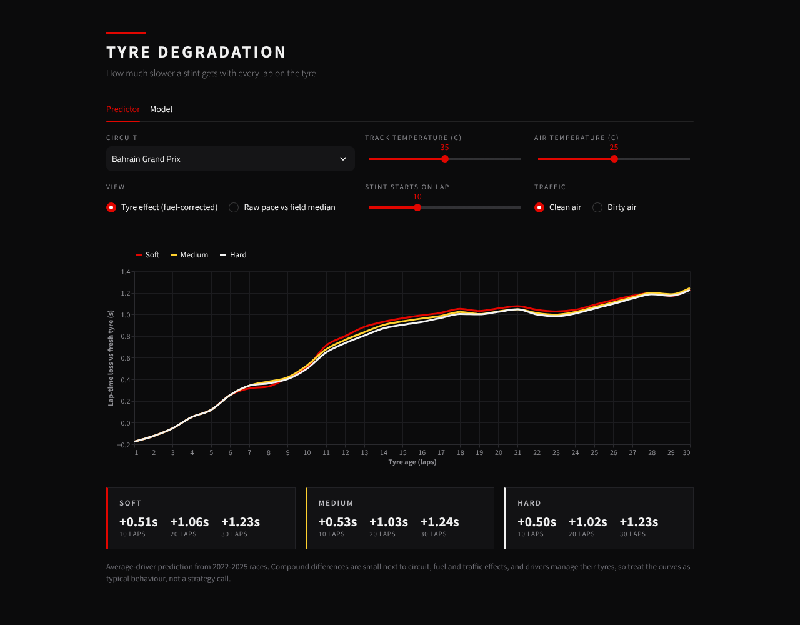

# F1 Tyre Degradation

How much slower does an F1 car get with every lap on a tyre, and how fast is a lap going to be? Built from scratch with NumPy and pandas on FastF1 race data (2022 to 2025). No scikit-learn, XGBoost or PyTorch.



## What it does

- **Lap-time model.** Gradient boosting (pinball loss, written in `f1tyre/numpy_ml.py`) predicts a lap relative to the race's field-median lap, in three tiers: pre-lap, pre-stint and live.
- **Degradation model.** Within-stint least squares compares every stint only with itself, so driver, car and strategy cancel out. It gives the compound and circuit curves in the app.
- **Circuit characteristics.** Thirteen measures (speed, braking, cornering load, elevation and others) taken from each circuit's fastest-lap telemetry. Cross-validation kept one: elevation change per km.
- **Tyre cliff detection.** Every stint of 20 or more laps is tested for a late speed-up in lap-time loss, with stints that slow down by the same amount as the noise reference.
- **App.** Predictor (curves, a band for the average or for single stints, and a fuel-burn view), Race explorer (real stints against the model, with cliffs marked), Circuits (ranking) and Model (scores, cliff results, circuit characteristics).

## Results

Unseen 2025 races, trained on 2022 to 2024 (24 races, 18,738 laps):

| Model | MAE (s) | R2 |
|---|---|---|
| Median baseline | 0.875 | 0.00 |
| Formula (fuel and form, fitted) | 0.588 | 0.46 |
| Ridge regression | 0.503 | 0.60 |
| **Gradient boosting, pre-lap** | **0.468** | **0.66** |
| **Gradient boosting, pre-stint** | **0.437** | **0.70** |
| Persistence (last 3 laps) | 0.368 | 0.72 |
| **Gradient boosting, live** | **0.294** | **0.82** |

- **Pre-lap:** everything known at the start of the lap except the driver's own previous laps.
- **Pre-stint:** adds the driver's earlier stints in the same race. On laps in stint 2 or later, MAE falls from 0.500 to 0.457 s.
- **Live:** adds recent laps of the current stint, 20% better than persistence.
- Mixed-year 5-fold cross-validation over 90 races (the main estimate): MAE 0.494 / 0.461 / 0.310 for pre-lap / pre-stint / live.
- 90% prediction intervals (conformal) cover 93% of 2025 laps in every tier.

Degradation on unseen 2025 stints (seconds lost per lap of tyre age):

| Compound | Actual | Predicted |
|---|---|---|
| Soft | 0.067 | 0.064 |
| Medium | 0.050 | 0.049 |
| Hard | 0.038 | 0.038 |

Soft wears about 1.7 times faster than hard, in every season. The curve is a parabola because it reproduced the observed tyre-age curve best on held-out stints (error 0.136 s against 0.145 to 0.147 s for flexible shapes). It is the average lap: over all 3,353 stints it sits 13% below the average stint slope, because long stints dominate the fit and are the gentle ones, and single stints differ a lot.

**Tyre cliff.** Each stint of 20 or more laps is fitted with a straight line and with a line that steepens at one age. A stint that speeds up by at least 0.1 s per lap, at an age in the second half of the stint, is a cliff. Stints that slow down by the same amount are the noise reference.

| Compound | Stints | Cliff | Noise reference | Median onset (lap) | Extra loss after onset (s per lap) |
|---|---|---|---|---|---|
| Soft | 102 | 10% | 1% | 18.5 | 0.25 |
| Medium | 509 | 4% | 1% | 21 | 0.25 |
| Hard | 960 | 7% | 2% | 27 | 0.25 |

About 4% of long stints have a real cliff (6% against a 1.5% noise reference), typically 0.25 s per lap steeper afterwards, starting at a median age of 24 laps. Most stints are pitted before one, and onset ages vary, so an average curve cannot show it. The Race explorer marks detected cliffs.

**Circuit characteristic.** Elevation change per km correlates 0.59 with measured circuit severity (p = 0.02 after allowing for picking the best of 13 characteristics, and 0.55 to 0.66 when any one circuit is dropped). No physical mechanism is proven.

Full tables, bootstrap intervals and ablations: `results/summary.md` and `report/report.pdf`.

## Run it

```
pip install -r requirements.txt
python -m unittest discover -s tests -t .   # tests, including a no-future-leakage check
streamlit run app.py                        # the app
python evaluate.py                          # lap-level scores (about 10 minutes)
python evaluate_degradation.py              # degradation model and circuit analysis
python predict_demo.py "Bahrain Grand Prix" 35
```

The data is in `data/`, so no F1 account is needed. To download it again, install `fastf1`, copy `.env.example` to `.env`, add an F1 account and run `python fetch_data.py` then `python fetch_circuits.py`.

## Layout

```
app.py, evaluate*.py, predict_demo.py, fetch_*.py
f1tyre/      config, data, features, circuits, degradation, cliff, numpy_ml, models, metrics
tests/       unit tests
data/        race laps (92 CSVs) and circuits.csv
results/     metrics, figures, summary
report/      report.pdf and editable report.docx, with build scripts
reference_sklearn_xgboost/   earlier scikit-learn and XGBoost version, for comparison
```

Lap data comes from FastF1 (Formula 1 timing data). Keep the repository private.
