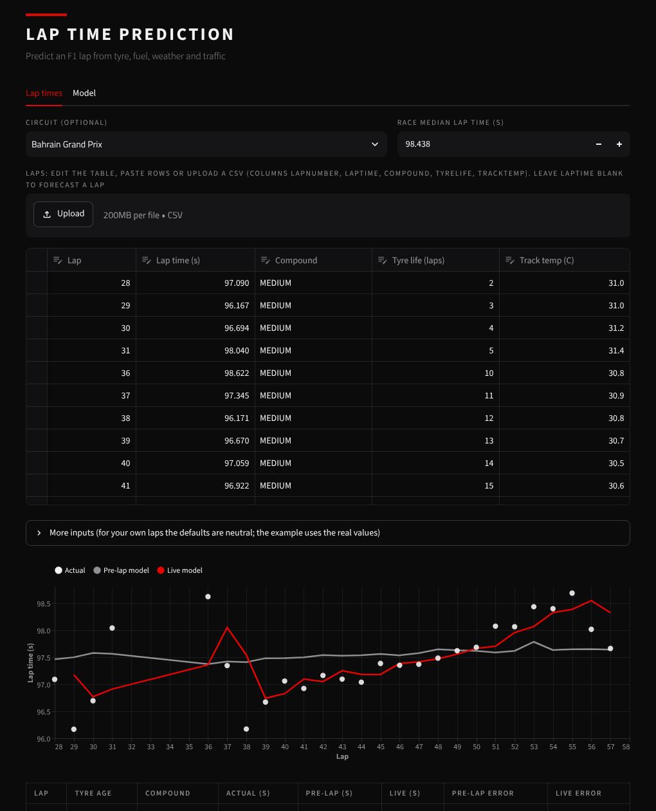

# F1 Lap Time Prediction

How fast will an F1 lap be, given the tyre and its wear, the fuel load, the weather, the car's form and the traffic? Built from scratch with NumPy and pandas on FastF1 race data (2022 to 2025). No scikit-learn, XGBoost or PyTorch.



## What it does

- **Lap-time model.** Gradient boosting (pinball loss, written in `f1tyre/gradient_boosting.py`) predicts a lap relative to the race's field-median lap, in three tiers: pre-lap, pre-stint and live.
- **Prediction intervals.** Two more boosting models at the 5% and 95% quantiles, calibrated with conformal prediction, give 90% intervals.
- **App.** A lap-time predictor that runs the pre-lap and live models on laps you type, paste or upload, and a Model tab with the scores and a button that re-runs the saved models on the 2025 test laps to verify them.

## What the model uses

**From FastF1** (race laps, 2022 to 2025): driver and team, lap number, lap time, tyre compound, tyre life, new or used tyre, stint number, track status (flags and safety cars), pit-in and pit-out laps, deleted and inaccurate laps, position, the time gaps to the cars ahead and behind (worked out from lap end times and positions), and the weather at each lap (air and track temperature, humidity, wind speed, rain). Circuit elevation change comes from the fastest-lap telemetry (position X, Y, Z).

**Target:** lap time minus the median lap time of that race, on clean dry green-flag laps only (no lap 1, pit laps, safety car, yellow flags or rain, and nothing slower than 104% of the driver's best).

**Features for gradient boosting**, built from those fields (every feature uses only information from before the lap):

| Group | Features | Tiers |
|---|---|---|
| Tyre | tyre life, its square and log, new-tyre flag, tyre life of 2 laps or less, compound (soft, medium, hard), tyre life by compound, stint number | all |
| Fuel | lap number, race fraction (lap divided by race length) | all |
| Weather | track temperature, air temperature, humidity, wind speed, track minus air temperature | all |
| Form | driver and team average pace over their previous 3, 5 and 10 races | all |
| Traffic | gaps to the cars ahead and behind, position, and a dirty-air flag (under 1.5 s behind another car), all from the previous lap | all |
| Field context | how the whole field's pace changed recently, laps since the last safety car or yellow flag | all |
| Circuit | elevation change per km | all |
| Earlier stints | driver's mean pace in earlier stints of the race, pace at the end of the previous stint, previous stint length | pre-stint, live |
| Recent laps | previous lap time, mean of the last 3 laps, laps since the previous clean lap | live |

Pre-lap uses the first seven groups, pre-stint adds earlier stints, and live adds recent laps. Pace is always relative to the race median lap.

## Results

Unseen 2025 races, trained on 2022 to 2024 (24 races, 18,738 laps):

| Model | MAE (s) | R2 |
|---|---|---|
| Median baseline | 0.875 | 0.00 |
| Formula (fuel and form, fitted) | 0.588 | 0.46 |
| Ridge regression | 0.503 | 0.60 |
| **Gradient boosting, pre-lap** | **0.468** | **0.66** |
| **Gradient boosting, pre-stint** | **0.437** | **0.70** |
| Persistence (last 3 laps) | 0.368 | 0.72 |
| **Gradient boosting, live** | **0.294** | **0.82** |

- **Pre-lap:** everything known at the start of the lap except the driver's own previous laps.
- **Pre-stint:** adds the driver's earlier stints in the same race. On laps in stint 2 or later, MAE falls from 0.500 to 0.457 s.
- **Live:** adds recent laps of the current stint, 20% better than persistence.
- Mixed-year 5-fold cross-validation over 90 races (the main estimate): MAE 0.494 / 0.461 / 0.310 for pre-lap / pre-stint / live.
- 90% prediction intervals (conformal) cover 93% of 2025 laps in every tier.

Full tables, bootstrap intervals and ablations: `results/metrics.json` and `report/report.pdf`.

## Run it

```
pip install -r requirements.txt
streamlit run app.py          # the app, loads saved models from cached/ in about two seconds
python evaluate.py            # scores, checks and figures (about 10 minutes)
python -m f1tyre.serving      # refit and save everything the app loads (about one minute)
```

The data is in `data/`, so no F1 account is needed. To download it again, install `fastf1`, copy `.env.example` to `.env`, add an F1 account and run `python fetch_data.py`, then `python fetch_data.py circuits` for the circuit elevation.

## Layout

```
app.py                      Streamlit app
evaluate.py                 evaluation of all models
fetch_data.py               downloads laps and circuit elevation from FastF1
f1tyre/                     config, features, gradient_boosting, models, serving
cached/                     saved models and data the app loads
data/                       race laps (92 CSVs) and circuits.csv
results/                    metrics and figures
report/                     report.pdf and editable report.docx, with build scripts
```

Lap data comes from FastF1 (Formula 1 timing data). Keep the repository private.
